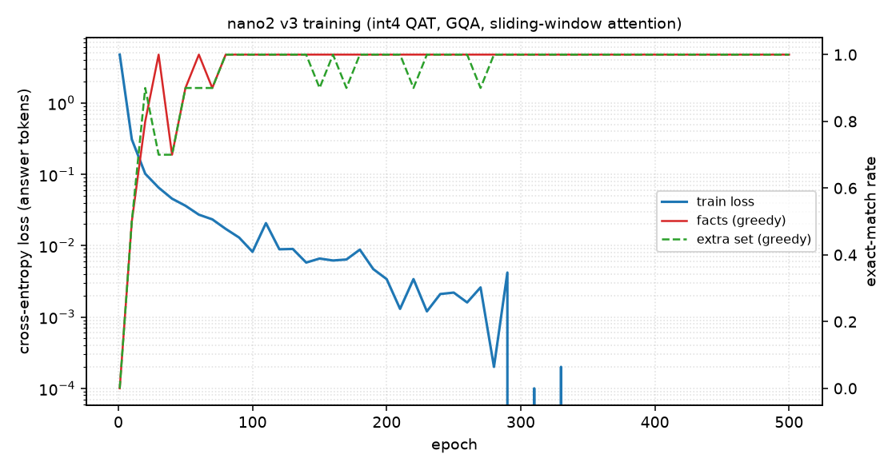

# nano2 —— 64 KB Flash 的 STM32F103C8T6 上跑 int4 量化小语言模型

> 改进自 [egger435/egg-nano](https://github.com/egger435/egg-nano)（原作者在 C8T6 上用 int8 跑了 4.2 万参数的 byte-level GPT）。
> 本项目保留"极限端侧"前提（**64 KB Flash / 20 KB SRAM、无 OS、无外部算力**），把量化换成 **int4 + QAT**、注意力换成 **GQA + 滑窗稀疏**、位置编码换成 **RoPE**、归一化换成 **RMSNorm**，并自建语料从头训练。
> 公开仓库里的语料使用占位人名。

---

## 1. 硬件与硬约束

| 项 | 值 |
|---|---|
| MCU | STM32F103C8T6，Cortex-M3 @72 MHz，**64 KB Flash / 20 KB SRAM** |
| 无 FPU / 无 DSP 扩展 / 无 cache / 无 MMU | 浮点靠软件库，int8 点积靠标量 `MUL` |
| 显示 | SSD1306 128×64（软件 IIC：SCL=PA6、SDA=PA5） |
| 串口 | USART1 115200 8N1（PA9/PA10） |
| 调试 | ST-Link V2 克隆（SWD） |

两条硬约束决定一切：

- **权重全部驻留 Flash** → 参数上限 ≈（64 KB − 代码 − 标度/偏置表）/ 0.5 B
- **KV cache 全部驻留 SRAM** → 上下文上限 ≈（20 KB − 其他缓冲）/ 每位置字节数

---

## 2. 模型架构

```
byte-level 输入（ASCII，vocab = 128，EOS = 0x7F）
  └─ token embedding 128×48（int4）
     └─ ×3 层：
          RMSNorm(γ) → QKV 投影 → RoPE(q,k) → GQA 注意力
                     （4 个 Q 头，2 组 KV，head_dim 12；滑窗 causal W=72 + 全局首 token）
                     → out 投影 → 残差
          RMSNorm(γ) → fc1(48→160) → GELU(LUT) → fc2(160→48) → 残差
     └─ RMSNorm(γ) → 权重绑定的 lm_head → argmax（贪心）
```

| 项 | 值 |
|---|---|
| 词表 | 128（byte-level ASCII） |
| 层数 | 3，Pre-RMSNorm，残差 |
| d_model | 48 |
| 注意力 | 4 Q 头 × head_dim 12，**GQA：2 组 KV（24 维）** |
| FFN | **160**（3.3× d_model） |
| 位置编码 | **RoPE**（half-split 旋转，base=10000，6 个频率，无位置表） |
| 归一化 | **RMSNorm**（不减均值、无 bias） |
| 上下文窗口 | **72 字节**（滑窗 + 全局首 token） |
| 参数 | **74,352**（其中 int4 权重 **72,960**，f32 伴随 1,392） |

### 2.1 三个结构选择的理由

**GQA（4 Q 头 / 2 组 KV）**

| 方案 | KV 维/层 | SRAM/位置 | 说明 |
|---|---|---|---|
| MHA（4 组） | 32 | 232 B | 基准 |
| **GQA（2 组）** | **16** | **184 B** | 本项目：Q 头数不变，计算量不变，只省 KV 的 SRAM/带宽 |
| MQA（1 组） | 8 | 88 B | 上下文能到 ~180，但表达力压得狠 |

**RoPE（替代可学习位置表）**

- 省掉 `96×48` 的 int8 位置表 + 标度 ≈ **5 KB Flash**
- 相对位置性质更好，窗口想加长时不用重做位置表
- 代价：每个 token 多 6 次 `cosf/sinf`（只跟位置有关，与层/头无关，可复用）

**RMSNorm（替代 LayerNorm）**

- 少一遍减均值、少一组 bias（省 336 个 f32 ≈ 1.3 KB Flash，也少一点计算）
- 3 层小模型上精度与 LayerNorm 持平（LLaMA 系已验证的做法）

### 2.2 滑窗稀疏注意力

- 每个位置只 attend 最近 72 个位置 + 第 0 个位置（全局 token）
- KV 用**环形缓冲**：写满覆盖最老的，**不再整段重算**（原版会 memmove + 全序列重算）
- 复杂度 O(T·W) 而非 O(T²)

---

## 3. 量化与 QAT

| 对象 | 格式 | 标度 | 备注 |
|---|---|---|---|
| 权重 | **int4**（[-7,7] 二补码，两值一字节） | **每输出行一个 f32 scale** | `w = scale × q` |
| 激活 | int8 动态 | 每 token 一个 scale（`amax/127`） | 进 GEMM 前量化 |
| K/V cache | int8 | 每位置一个 scale | — |
| bias | **int16** | 每张量一个 f32 scale | 比 f32 省 2.2 KB |
| RMSNorm γ、softmax | **f32 全程** | — | 精度关键路径不量化 |
| GELU | 161 点 LUT + 线性插值 | — | 误差 1e-3 < int8 噪声 4e-3 |

**QAT（STE 伪量化）**：训练前向里就把量化误差放进去（权重 fake-int4、激活 fake-int8、KV fake-int8），反向用 STE 直通。舍入一律 **away-from-zero**，与固件逐位一致——训练分布与部署分布对齐，避免"训得好、烧进去变傻"。

GEMM 溢出核算：`|acc| ≤ 127×127×160 ≈ 2.6e6 ≪ 2^31`，int32 累加即安全。

---

## 4. 语料

`corpus_v4.py`，模板 `q:{问题}\na:{答案}`，**纯 ASCII 英文**（1 字符 = 1 字节，72 字节窗口能装 70 个字母）。

| 类别 | 内容 | 条数 |
|---|---|---|
| 人物关系 | 18 个人物 × 4~5 种问法（who is / tell me about / do you know …）+ 关系链 + 歧义问答 | ~95 |
| 日常对话 | 问候、自我认知、情绪、爱好、边界拒绝 | ~70 |
| 数学 | 0-9 加减（3 种句式）、1-9×1-5 乘法、大小比较、数数 | ~780 |

- 去重后 **948 条**，按 `max_len=72` 过滤（超过部署窗口的样本直接丢弃）
- 训练时**加权采样**：人物事实/关系 ×8、闲聊 ×3、数学 ×1（数学条数太大，不加权会把事实淹没）
- 语料里没有任何查表/规则逻辑，人物关系完全由权重学会

---

## 5. 训练

```powershell
python corpus_v4.py
python train.py --epochs 350 --bs 64 --lr 3e-3
```

| 项 | 值 |
|---|---|
| 硬件 | 笔记本 CPU（i5-13500H，16 线程），PyTorch 2.15 CPU |
| 优化器 | AdamW，wd=0.01，β=(0.9,0.95) |
| 调度 | 50 步 warmup + cosine 退火到 5% |
| 规模 | batch 64，每 epoch 30 步，350 epoch ≈ 10,500 步 |
| 耗时 | **约 34 分钟**（~5.7 s/epoch） |
| 最终 loss | **≈ 1e-4**（答案段交叉熵，教师强制口径） |

### 5.1 loss 曲线



左轴：答案段交叉熵（对数坐标）；右轴：**贪心解码**整句命中率（红=人物事实 10 条，绿=其他 10 条）。

### 5.2 两个评估口径

| 口径 | 做法 | 用途 | 结果 |
|---|---|---|---|
| **教师强制** | 整段喂真实答案，逐位置比 argmax | 看"记住多少" | 字节 **100%** |
| **贪心自由生成** | 只给 prompt，模型自己吐 | 真实使用 | 见 §7 |

教师强制 100% 不代表生成质量——生成时吃的是自己上一步的输出，错误会累积；验收一律以贪心为准。

---

## 6. 部署

### 6.1 Flash / SRAM 实测预算

| Flash 项 | 占用 |
|---|---|
| int4 权重（72,960 × 0.5 B） | 36,480 B |
| 每行 f32 scale（1,232 个） | 4,928 B |
| bias int16（1,200 个） + scale | 2,424 B |
| RMSNorm γ（336 个 f32） | 1,344 B |
| RoPE 频率（6 个 f32） | 24 B |
| 代码（推理核 + UI + 驱动 + HAL） | ~15 KB |
| **合计** | **60,688 B / 65,536（92.6%）** |

| SRAM 项 | 占用 |
|---|---|
| KV 环形缓冲（3 层 × 72 位置 × 24 维 × int8 ×2 + 标度） | 13.2 KB |
| 中间缓冲（残差流 / FFN 行 / logits / 分数） | ~2.6 KB |
| OLED 帧缓冲 | 1.0 KB |
| 栈（余量 ~3.2 KB） | ~0.5 KB |
| **合计** | **17,272 B / 20,480（84.3%）** |

产物：`nano2.bin` = **60,812 B**（余 4,724 B）。

### 6.2 推理核（`fw/src/n2_model.c`，纯 C99）

- `gemm4()`：int4 解包（两值一字节）+ int32 累加 → `acc × act_scale × row_scale + bias×bias_scale`
- `quant8()`：逐 token 动态量化（away-from-zero）
- `rope_apply()`：half-split 旋转，配对 `(i, i+6)`，角度 `pos × 10000^(-i/6)`
- `rms_row()`：`x / sqrt(mean(x²)+1e-5) × γ`
- GQA 注意力：4 Q 头、2 组 KV；环形缓冲 + 全局槽；softmax 用 `expf`
- `gelu_one()`：161 点 LUT + 线性插值（与训练端同一张表）
- 输出：权重绑定的 lm_head，`acc × scale` 取 argmax

---

## 7. 验证

| 层 | 方法 | 结果 |
|---|---|---|
| 训练集自查 | 教师强制 | 字节 **100%** |
| numpy 整数路径模拟器 | 逐行复刻固件的 int4 解包 / 量化 / RoPE / RMSNorm / 环形 KV / LUT GELU，与 PyTorch 贪心解码比对 | **9/9 一致** |
| **宿主直跑固件 C 代码** | 用 gcc 把 `n2_model.c` + `n2_weights.c` 编成 PC 程序（`stm32f10x.h` 换空 shim），跑**要烧进板子的同一份源码** | **44/44** |
| **真机（v6）** | 串口逐条问答，44 条用例 | **44/44**（见 `验收报告_真机.md`） |

真机实测（C8T6 + SSD1306 + CH340，115200）：

| 提问 | 板上回答 | 耗时 |
|---|---|---|
| `who is alex chen` | `alex chen is my dad's best friend.` | 4.8 s / 36 B |
| `who is dana luo` | `dana luo is the ai lab stock god.` | 4.8 s / 36 B |
| `who is iris wang` | `iris wang is my master classmate.` | 5.5 s / 39 B |
| `dana luo is the ai lab stock god?` | `yes.` | 3.0 s / 5 B |
| `hi` | `hello!` | 0.8 s / 7 B |
| `what is 7+8` | `15.` | 1.1 s / 4 B |
| `how is the weather` | `i do not know.` | 2.6 s / 15 B |

**刷完之后验证**：固件运行中 OpenOCD 直接 `Examination succeed`（`Cortex-M3 r1p1` 检测到），
即 **`DBGMCU_CR |= 7` 生效，以后可以纯在线烧录**，不用再动 BOOT0。

> 宿主这层是必须的：它抓到过 `export_c.py` 里 `tok_emb`/`pos_emb` 多转置一次的 bug（numpy 模拟器用 ckpt 原始布局，抓不到）。

---

## 8. 踩过的坑（可复用）

1. **SWD "能读 ID、AP 全 fault"**：固件 `__WFI()` 进 Sleep，而 `DBGMCU_CR` 的 `DBG_SLEEP/STOP/STANDBY` 默认 0 → 内核时钟停 → AHB-AP 不可访问。修复：`DBGMCU->CR |= 0x00000007;`。**看起来像芯片坏了，其实一行代码。**
2. **OLED 黑屏**：重写 UI 时漏调 `OLED_Init()`（软件 IIC 引脚 + 电荷泵使能）。
3. **权重导出布局**：PyTorch 是 `[in][out]`，固件要 `[out][in]`；`tok_emb` 本身就是 `[out][in]`，不能无脑转置。
4. **int4 的 f32 字面量**：`"%.9g" % 0` 生成 `0`，拼上 `f` 变成非法 `0f`。
5. **训练样本要按部署窗口过滤**：超过窗口的样本会让模型学到"窗口外永远答错"。
6. **Windows 下 gcc 需要可写 TMP**，PowerShell 5.1 的 `Tee-Object` 默认写 UTF-16，解析日志要自动探测编码。

---

## 9. 局限与后续

| 限制 | 现况 | 下一步 |
|---|---|---|
| 容量 | FLASH 92.6%，余 4.7 KB | 还能把 FFN 160→176（+2.3 KB）；再往上要换 F103RC（256 KB）或 F4 |
| 上下文 | 72 字节（SRAM 84.3%） | KV 改 int4 可到 ~150；或换线性注意力/minGRU（状态恒定） |
| 语言 | 纯英文 | 中文需 UTF-8 词表 + 12×12 点阵字库（本仓库的 v3 分支做过，占 96.2% Flash） |
| 生成速度 | 长答 ~5 s | UI 改成每 3~4 字符重绘一次（软件 IIC 是瓶颈） |

---

## 10. 复现

```powershell
python corpus_v4.py            # 语料
python train.py --epochs 350   # 训练（CPU ≈34 min）
python export_c.py             # 导出 int4 权重到 fw/src/n2_weights.{c,h}
cd fw; python build_n2.py --clean    # 构建固件（arm-none-eabi-gcc）
cd ..; python build_host.py; python acceptance_host.py   # 宿主验证
powershell -File ..\tools\flash_n2.ps1                   # 烧录
python test_board_full.py COM12                           # 真机验收
```
